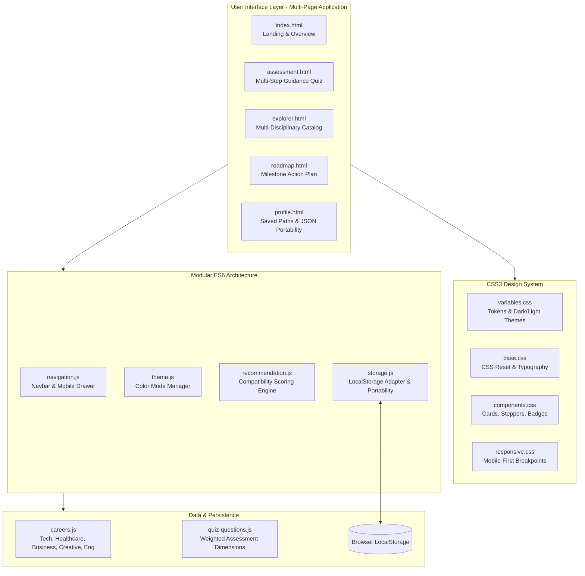

# Customized Digital Guidance Platform (2025)
> **Technologies: HTML5, CSS3, JavaScript (ES6+ Modules), Web Architecture**  
> *A responsive, privacy-first web application delivering personalized career and higher education advisory resources for students.*


---

## 🌟 Overview

The **Customized Digital Guidance Platform** bridges the gap between academic education and industry readiness. Built using modern web standards, it empowers students and career switchers to discover tailored career pathways through an interactive multi-dimensional assessment quiz, dynamic career exploration across 5 disciplines, and actionable milestone roadmaps.

### Key Capabilities:
- 🎯 **Multi-Vector Assessment Quiz**: 4-step progressive evaluation analyzing cognitive drive, problem-solving style, work dynamic, and long-term impact.
- 📐 **Vector Cosine Compatibility Engine**: Projects student responses across 5 dimensions and calculates true mathematical compatibility scores against career profiles.
- 🌐 **Multi-Disciplinary Career Explorer**: In-depth directory spanning **Technology, Healthcare, Business & Finance, Creative Arts, and Engineering** with live search and facet filters.
- 🗺️ **Stateful Milestone Roadmaps**: Step-by-step career readiness timelines with interactive completion checklists and resource guides.
- 🌗 **CSS3 Design System & Theme Engine**: Token-driven styling with fluid typography, responsive Grid/Flexbox layouts, and automatic dark/light mode switching.
- 💾 **Client-Side Data Sovereignty**: Operates offline-first using a robust LocalStorage adapter with instant JSON profile export and import.

---

## 🏗️ System Architecture



---

## 🚀 Quick Start / Local Preview

Because this project is built using native **HTML5, CSS3, and ES6 JavaScript Modules**, it requires **zero external dependencies** or npm compilation.

### Option 1: Run with Python (Recommended for ES Modules)
```bash
# In the project directory:
python -m http.server 8000
```
Then visit: [`http://localhost:8000`](http://localhost:8000)

### Option 2: Run with Node.js / npx
```bash
npx serve .
```

### Option 3: VS Code Live Server
Right-click `index.html` in VS Code and click **"Open with Live Server"**.

---

## 📁 Repository Structure

```
NP/
├── index.html                      # Landing page, value proposition & stats
├── assessment.html                 # 4-Step interactive guidance stepper
├── explorer.html                   # Multi-facet search, domain filters & catalog
├── roadmap.html                    # Sequential milestone checklist & learning resources
├── profile.html                    # Saved bookmarks, past assessments & JSON portability
├── css/
│   ├── variables.css               # Design tokens, color scales & light/dark modes
│   ├── base.css                    # CSS reset, typography & layout containers
│   ├── components.css              # Cards, steppers, badges, buttons & timelines
│   └── responsive.css              # Breakpoints (<992px, <768px, <480px)
├── js/
│   ├── data/
│   │   ├── careers.js              # 10+ Multi-disciplinary careers dataset
│   │   └── quiz-questions.js       # 4-Step weighted assessment questions
│   ├── modules/
│   │   ├── storage.js              # Storage Adapter (persistence & JSON portability)
│   │   ├── theme.js                # Dark/Light theme manager & OS listener
│   │   ├── navigation.js           # Responsive drawer & active link highlighting
│   │   └── recommendation.js       # Cosine matching & scoring algorithm
│   └── pages/
│       ├── home.js                 # Homepage controller & dynamic banner
│       ├── assessment.js           # Quiz stepper & radar results controller
│       ├── explorer.js             # Live search, filters & bookmarking controller
│       ├── roadmap.js              # Timeline & checklist controller
│       └── profile.js              # Student records & JSON export/import controller
├── docs/
│   ├── architecture.md             # Technical design specifications & trade-offs
│   └── resume-and-interview-guide.md # STAR resume bullet points & interview script
└── README.md                       # Main documentation (this file)
```

---

## 🧮 Recommendation Algorithm

The platform models each student's assessment choices as a 5-dimensional preference vector:
1. `technology`: Computational systems, coding, and infrastructure.
2. `analytical`: Statistical modeling, empirical research, and data rigor.
3. `problemSolving`: Systems architecture, troubleshooting, and applied engineering.
4. `leadership`: Strategic vision, product management, and team coordination.
5. `creative`: Aesthetic design, interaction design, and visual storytelling.

The engine computes the **Cosine Similarity** between the normalized student vector and each career vector:

$$\text{Sim}(\mathbf{U}, \mathbf{C}_i) = \frac{\mathbf{U} \cdot \mathbf{C}_i}{\|\mathbf{U}\| \|\mathbf{C}_i\|}$$

The compatibility score is mapped to a realistic student advisory scale:

$$\text{MatchScore}_i = \text{round}\left(65 + 33 \cdot \text{Sim}(\mathbf{U}, \mathbf{C}_i)\right)$$

---

## 📚 Portfolio Documentation

- 📄 **[Technical Architecture & Design Specs](docs/architecture.md)**: In-depth analysis of architectural patterns, data flow sequence diagrams, and technology trade-offs.
- 🎯 **[Resume & Interview Talking Points Guide](docs/resume-and-interview-guide.md)**: Polished STAR-method resume bullet points, behavioral question answers, and a 2-minute live demo walkthrough script.

---

## 📄 License
This project is open-source under the [MIT License](LICENSE).
