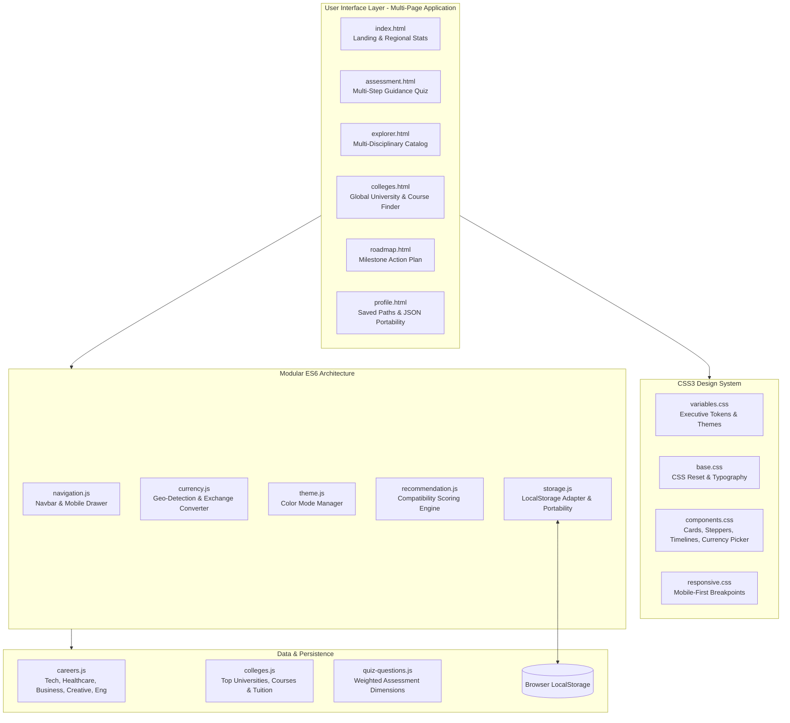

# Customized Digital Guidance Platform (2025) - Global Edition
> **Technologies: HTML5, CSS3, JavaScript (ES6+ Modules), Web Architecture**  
> *A responsive, privacy-first web application delivering personalized career roadmaps, global college course matching, and automatic worldwide currency localization.*


---

## 🌟 Executive Overview

The **Customized Digital Guidance Platform** bridges the gap between academic education and industry readiness worldwide. Built using modern web standards, it empowers students globally to discover tailored career pathways, find premier universities offering required degree courses, and review real-time financial estimates formatted automatically in their native currency.

### Key Capabilities:
- 🌍 **Worldwide Currency & Geo-Localization**: Automatically detects visitor's region via browser `Intl` and timezone APIs, converting all salaries and college tuition fees into **INR (₹), USD ($), EUR (€), GBP (£), CAD (CA$), AUD (A$), SGD (S$), AED, JPY (¥), or CHF**. Includes an interactive top-bar currency switcher.
- 🎓 **Global University & Course Directory (`colleges.html`)**: Search and filter accredited universities across the **USA, UK, Switzerland, Germany, Singapore, India, Canada, Australia, and Japan**. Inspect required entrance exams (SAT, ACT, GRE, JEE Advanced, GATE, IELTS) and admission acceptance rates.
- 🎯 **Multi-Vector Assessment Quiz (`assessment.html`)**: 4-step progressive questionnaire analyzing cognitive drive, problem-solving style, work dynamic, and long-term impact.
- 📐 **Vector Cosine Compatibility Engine**: Projects student responses across 5 dimensions and calculates true mathematical compatibility scores against career profiles.
- 🌐 **Multi-Disciplinary Career Explorer (`explorer.html`)**: In-depth directory spanning **Technology, Healthcare, Business & Finance, Creative Arts, and Engineering** with live search, localized salaries, and direct links to matching universities.
- 🗺️ **Stateful Milestone Roadmaps (`roadmap.html`)**: Step-by-step career readiness timelines with interactive completion checklists, resource guides, and degree programs.
- 🌗 **Executive CSS3 Design System**: Token-driven styling with fluid typography, responsive Grid/Flexbox layouts, glassmorphic cards, and automatic dark/light mode switching.
- 💾 **Client-Side Data Sovereignty**: Operates offline-first using a robust LocalStorage adapter with instant JSON profile export and import.

---

## 🏗️ System Architecture



---

## 🚀 Quick Start / Local Preview

Because this project is built using native **HTML5, CSS3, and ES6 JavaScript Modules**, it requires **zero external dependencies** or build steps.

### Option 1: Run with Python (Recommended for ES Modules)
```bash
# In the project directory:
python -m http.server 8000
```
Then visit: [`http://localhost:8000`](http://localhost:8000)

### Option 2: Run with Node.js / npx
```bash
npx serve .
```

---

## 📁 Repository Structure

```
NP/
├── index.html                      # Landing, regional value prop & featured pathways
├── assessment.html                 # 4-Step interactive guidance stepper
├── explorer.html                   # Multi-facet search, domain filters & localized compensation
├── colleges.html                   # Global university finder, degree courses & tuition in local currency
├── roadmap.html                    # Sequential milestone checklist & matched colleges
├── profile.html                    # Saved bookmarks, past assessments & JSON portability
├── css/
│   ├── variables.css               # Design tokens, color scales & light/dark modes
│   ├── base.css                    # CSS reset, typography & layout containers
│   ├── components.css              # Cards, steppers, badges, buttons, timelines & currency picker
│   └── responsive.css              # Breakpoints (<992px, <768px, <480px)
├── js/
│   ├── data/
│   │   ├── careers.js              # Multi-disciplinary careers with numeric salary benchmarks
│   │   ├── colleges.js             # Global universities across 10+ countries with tuition & exams
│   │   └── quiz-questions.js       # 4-Step weighted assessment questions
│   ├── modules/
│   │   ├── currency.js             # Geolocation detection & exchange rate converter
│   │   ├── storage.js              # Storage Adapter (persistence & JSON portability)
│   │   ├── theme.js                # Dark/Light theme manager & OS listener
│   │   ├── navigation.js           # Responsive drawer, active links & currency dropdown
│   │   └── recommendation.js       # Cosine matching & scoring algorithm
│   └── pages/
│       ├── home.js                 # Homepage controller & dynamic banner
│       ├── assessment.js           # Quiz stepper & radar results controller
│       ├── explorer.js             # Live search, filters & bookmarking controller
│       ├── colleges.js             # Global university directory controller
│       ├── roadmap.js              # Timeline, checklist & matched courses controller
│       └── profile.js              # Student records & JSON export/import controller
├── docs/
│   ├── architecture.md             # Technical design specifications & trade-offs
│   └── resume-and-interview-guide.md # STAR resume bullet points & interview script
└── README.md                       # Main documentation (this file)
```

---

## 📚 Portfolio Documentation

- 📄 **[Technical Architecture & Design Specs](docs/architecture.md)**: In-depth analysis of architectural patterns, data flow sequence diagrams, and technology trade-offs.
- 🎯 **[Resume & Interview Talking Points Guide](docs/resume-and-interview-guide.md)**: Polished STAR-method resume bullet points, behavioral question answers, and a 2-minute live demo walkthrough script.

---

## 📄 License
This project is open source and available under the terms of the [MIT License](https://opensource.org/licenses/MIT).
