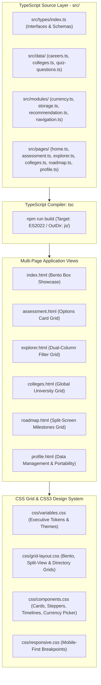

# Customized Digital Guidance Platform (2025) - TypeScript & CSS Grid Edition
> **Technologies: TypeScript, HTML5, CSS3 (CSS Grid Architecture), Web Architecture**  
> *A responsive, privacy-first web application delivering personalized career roadmaps, worldwide university course matching, and regional currency localization.*


---

## 🌟 Executive Overview

The **Customized Digital Guidance Platform** bridges the gap between academic education and industry readiness worldwide. Engineered with **TypeScript** and an advanced **CSS Grid Architecture**, it empowers students globally to discover tailored career pathways, find premier universities offering required degree courses, and review real-time financial estimates formatted automatically in their native currency.

### Key Capabilities:
- ⚡ **Strictly Typed TypeScript Core (`src/`)**: 100% strongly typed interfaces (`Career`, `College`, `QuizQuestion`, `AppState`, `CurrencyRate`) with zero runtime errors and automated `tsc` build scripts.
- 📐 **Advanced CSS Grid Layout System (`css/grid-layout.css`)**:
  - **12-Column Bento Grid**: Executive dashboard showcase on the landing page highlighting global platform metrics, regional currency detection, and matching mathematics.
  - **Explorer Dual-Column Grid**: Sticky filter sidebar paired with an adaptive multi-column card directory.
  - **Roadmap Split-Screen Grid**: Phase-by-phase sequential milestones on the left with sticky university degree matches and certifications on the right.
  - **Interactive Options Card Grid**: Responsive grid layout transforming quiz questions into touch-friendly selection tiles.
- 🌍 **Worldwide Currency & Geo-Localization**: Automatically detects visitor's region via browser `Intl` and timezone APIs, converting all salaries and college tuition fees into **INR (₹), USD ($), EUR (€), GBP (£), CAD (CA$), AUD (A$), SGD (S$), AED, JPY (¥), or CHF**. Includes an interactive top-bar currency switcher.
- 🎓 **Global University & Course Directory (`colleges.html`)**: Search and filter accredited universities across the **USA, UK, Switzerland, Germany, Singapore, India, Canada, Australia, and Japan**. Inspect required entrance exams (SAT, ACT, GRE, JEE Advanced, GATE, IELTS) and admission acceptance rates.
- 🎯 **Multi-Vector Assessment Quiz (`assessment.html`)**: 4-step progressive questionnaire analyzing cognitive drive, problem-solving style, work dynamic, and long-term impact.
- 📐 **Vector Cosine Compatibility Engine**: Projects student responses across 5 dimensions and calculates true mathematical compatibility scores against career profiles.
- 🌐 **Multi-Disciplinary Career Explorer (`explorer.html`)**: In-depth directory spanning **Technology, Healthcare, Business & Finance, Creative Arts, and Engineering** with live search, localized salaries, and direct links to matching universities.
- 💾 **Client-Side Data Sovereignty**: Operates offline-first using a robust LocalStorage adapter with instant JSON profile export and import.

---

## 🏗️ System Architecture



---

## 🚀 Quick Start / Development Commands

### 1. Compile TypeScript
```bash
# Typecheck and build all TypeScript source files into js/
npm run build

# Watch mode during development:
npm run watch

# Pure type-checking without emitting:
npm run typecheck
```

### 2. Run Local Preview
```bash
# With Python:
python -m http.server 8000

# Or with Node.js:
npx serve .
```
Visit [`http://localhost:8000`](http://localhost:8000).

---

## 📁 Repository Structure

```
NP/
├── package.json                    # Project configuration, scripts & TypeScript dependency
├── tsconfig.json                   # Strict TypeScript compiler configuration
├── index.html                      # Landing page with 12-Column Bento Grid
├── assessment.html                 # 4-Step guidance stepper with Options Card Grid
├── explorer.html                   # Dual-column career explorer with sticky filter sidebar
├── colleges.html                   # Global university finder & localized tuition grid
├── roadmap.html                    # Split-view sequential milestone checklist & degree matches
├── profile.html                    # Saved bookmarks, past assessments & JSON portability
├── css/
│   ├── variables.css               # Design tokens, color scales & light/dark modes
│   ├── grid-layout.css             # Bento box, dual-column explorer, and split-view grids
│   ├── base.css                    # CSS reset, typography & layout containers
│   ├── components.css              # Cards, steppers, badges, buttons & currency picker
│   └── responsive.css              # Breakpoints (<1024px, <768px, <480px)
├── src/                            # Strongly-typed TypeScript Source Code
│   ├── types/
│   │   └── index.ts                # TypeScript interfaces (Career, College, Quiz, State)
│   ├── data/
│   │   ├── careers.ts              # Multi-disciplinary careers with salary bounds
│   │   ├── colleges.ts             # Global universities across 10+ countries
│   │   └── quiz-questions.ts       # 4-Step weighted assessment rubrics
│   ├── modules/
│   │   ├── currency.ts             # Geolocation detection & exchange rate converter
│   │   ├── storage.ts              # Storage Adapter (persistence & JSON portability)
│   │   ├── theme.ts                # Dark/Light theme manager & OS listener
│   │   ├── navigation.ts           # Responsive drawer, active links & currency dropdown
│   │   └── recommendation.ts       # Cosine matching & scoring algorithm
│   └── pages/
│       ├── home.ts                 # Homepage Bento controller
│       ├── assessment.ts           # Quiz stepper & radar results controller
│       ├── explorer.ts             # Live search, filters & bookmarking controller
│       ├── colleges.ts             # Global university directory controller
│       ├── roadmap.ts              # Split-view checklist & matched courses controller
│       └── profile.ts              # Student records & JSON export/import controller
├── js/                             # Compiled production JavaScript modules (from src/)
├── docs/
│   ├── architecture.md             # Technical design specifications & trade-offs
│   └── resume-and-interview-guide.md # STAR resume bullet points & interview script
└── README.md                       # Main documentation (this file)
```

---

## 📚 Portfolio Documentation

- 📄 **[Technical Architecture & Design Specs](docs/architecture.md)**: In-depth analysis of architectural patterns, data flow sequence diagrams, and technology trade-offs.
- 🎯 **[Resume & Interview Talking Points Guide](docs/resume-and-interview-guide.md)**: Polished STAR-method resume bullet points, behavioral question answers, and a 2-minute live demo walkthrough script.

---

## 📄 License
This project is open source and available under the terms of the [MIT License](https://opensource.org/licenses/MIT).
