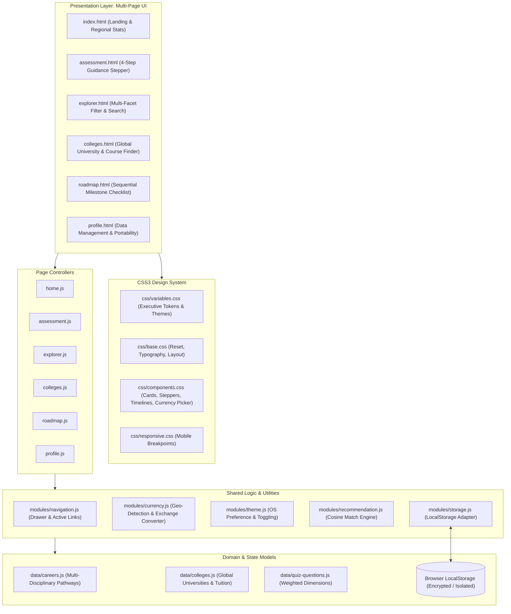
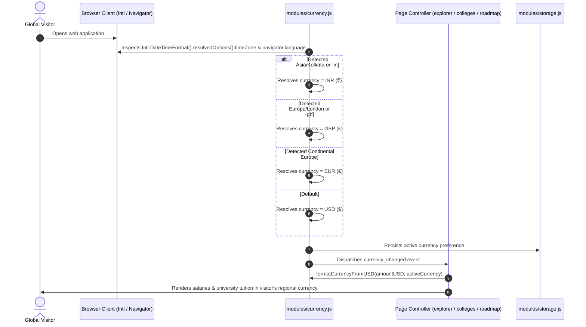

# Web Architecture & Technical Design Specification
**Career Guide**  
*Technologies: TypeScript, HTML5, CSS3 (CSS Grid Architecture), Web Architecture*

---

## 1. Executive Summary & Architectural Goals

The **Customized Digital Guidance Platform** is engineered as a high-performance, accessible, and privacy-first Multi-Page Application (MPA). Its primary mission is to deliver customized career discovery and higher education transition resources to students through real-time multi-dimensional assessment scoring, global university course matching, and automatic worldwide currency localization.

### Core Architectural Goals:
1. **Zero-Build Portability**: Executes natively in modern web browsers using standard ES6 modules without compilation or heavy toolchains.
2. **Worldwide Currency Localization**: Automatically detects the visitor's geographic region via browser `Intl` and timezone APIs, dynamically converting and formatting salary bands and college tuition in their native currency (INR, USD, EUR, GBP, CAD, AUD, JPY, SGD, AED, CHF).
3. **Global Higher Education Integration**: Seamlessly maps career paths to premier accredited universities and degree courses worldwide (USA, UK, Germany/Europe, Singapore, India, Canada, Australia, Japan) with entrance exam requirements and acceptance metrics.
4. **Defensive Data Sovereignty**: Operates client-first using an isolated LocalStorage adapter with JSON export/import capabilities.
5. **Token-Driven CSS3 Design System**: Implements unified design tokens via CSS custom properties, responsive Grid/Flexbox layouts, glassmorphic card overlays, and dynamic dark/light theming.

---

## 2. High-Level System Architecture



---

## 3. Worldwide Currency & Geolocation Pipeline



---

## 4. Directory Structure

```
NP/
├── index.html                      # Landing, regional value prop & featured pathways
├── assessment.html                 # 4-Step interactive guidance stepper
├── explorer.html                   # Multi-facet search, domain filters & localized compensation
├── colleges.html                   # Global university finder, degree courses & tuition in local currency
├── roadmap.html                    # Sequential milestone checklist & matched colleges
├── profile.html                    # Saved bookmarks, past assessments & JSON portability
├── css/
│   ├── variables.css               # Design tokens, color scales & light/dark modes
│   ├── base.css                    # CSS reset, typography & layout containers
│   ├── components.css              # Cards, steppers, badges, buttons, timelines & currency picker
│   └── responsive.css              # Breakpoints (<992px, <768px, <480px)
├── js/
│   ├── data/
│   │   ├── careers.js              # Multi-disciplinary careers with numeric salary benchmarks
│   │   ├── colleges.js             # Global universities across 10+ countries with tuition & exams
│   │   └── quiz-questions.js       # 4-Step weighted assessment questions
│   ├── modules/
│   │   ├── currency.js             # Geolocation detection & exchange rate converter
│   │   ├── storage.js              # Storage Adapter (persistence & JSON portability)
│   │   ├── theme.js                # Dark/Light theme manager & OS listener
│   │   ├── navigation.js           # Responsive drawer, active links & currency dropdown
│   │   └── recommendation.js       # Cosine matching & scoring algorithm
│   └── pages/
│       ├── home.js                 # Homepage controller & dynamic banner
│       ├── assessment.js           # Quiz stepper & radar results controller
│       ├── explorer.js             # Live search, filters & bookmarking controller
│       ├── colleges.js             # Global university directory controller
│       ├── roadmap.js              # Timeline, checklist & matched courses controller
│       └── profile.js              # Student records & JSON export/import controller
├── docs/
│   ├── architecture.md             # Technical design specifications (this file)
│   └── resume-and-interview-guide.md # STAR resume bullet points & interview guide
└── README.md                       # Main documentation
```
