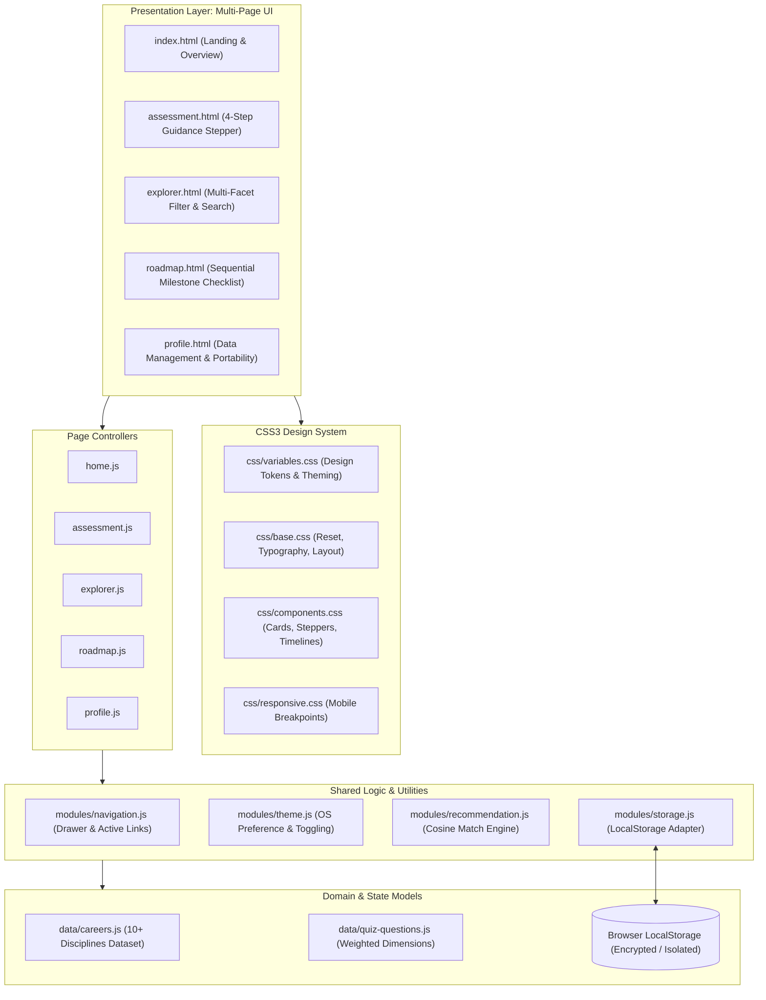
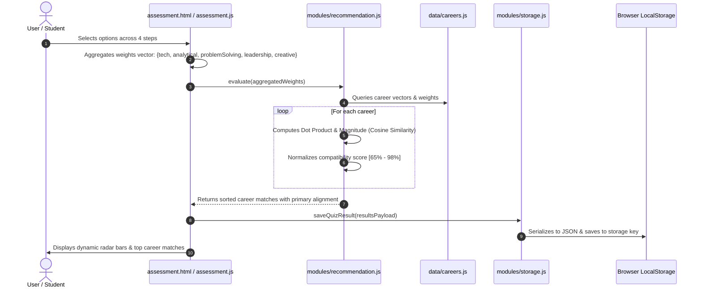

# Web Architecture & Technical Design Specification
**Customized Digital Guidance Platform (2025)**  
*Technologies: HTML5, CSS3, JavaScript (ES6+ Modules), Web Architecture*

---

## 1. Executive Summary & Architectural Goals

The **Customized Digital Guidance Platform** is engineered as a high-performance, accessible, and privacy-first Multi-Page Application (MPA). Its primary mission is to deliver customized career discovery and higher education transition resources to students through real-time multi-dimensional assessment scoring and milestone tracking.

### Core Architectural Goals:
1. **Zero-Build Portability**: Executes natively in modern web browsers using standard ES6 modules without compilation or heavy toolchains.
2. **Defensive Data Sovereignty**: Operates client-first using an isolated LocalStorage adapter with JSON export/import capabilities.
3. **Multi-Vector Recommendation Logic**: Implements vector projection and cosine compatibility scoring across five cognitive and technical dimensions.
4. **Token-Driven CSS3 Design System**: Implements unified design tokens via CSS custom properties, responsive Grid/Flexbox layouts, and dynamic dark/light theming.

---

## 2. High-Level System Architecture



---

## 3. Data Flow & Recommendation Engine Pipeline

The core value proposition relies on translating student self-reflection into actionable, ranked career recommendations:



---

## 4. Mathematical Foundation of the Matching Engine

Let the user's aggregated score vector be:
$$\mathbf{U} = \begin{bmatrix} u_{\text{tech}} \\ u_{\text{analytical}} \\ u_{\text{problemSolving}} \\ u_{\text{leadership}} \\ u_{\text{creative}} \end{bmatrix}$$

Let a career candidate vector in the database be:
$$\mathbf{C}_i = \begin{bmatrix} c_{i,\text{tech}} \\ c_{i,\text{analytical}} \\ c_{i,\text{problemSolving}} \\ c_{i,\text{leadership}} \\ c_{i,\text{creative}} \end{bmatrix}$$

The cosine similarity metric is computed as:
$$\text{Sim}(\mathbf{U}, \mathbf{C}_i) = \frac{\mathbf{U} \cdot \mathbf{C}_i}{\|\mathbf{U}\| \|\mathbf{C}_i\|} = \frac{\sum_{k=1}^5 u_k \cdot c_{i,k}}{\sqrt{\sum_{k=1}^5 u_k^2} \sqrt{\sum_{k=1}^5 c_{i,k}^2}}$$

To project the cosine similarity into an intuitive student advisory percentage:
$$\text{MatchScore}_i = \text{round}\left(65 + 33 \cdot \text{Sim}(\mathbf{U}, \mathbf{C}_i)\right)$$

This guarantees non-zero realistic encouragement (baseline $65\%$) while rewarding strong domain alignment up to $98\%$.

---

## 5. Architectural Trade-Off Analysis

| Architectural Decision | Chosen Approach | Alternative Considered | Justification |
| :--- | :--- | :--- | :--- |
| **App Model** | Multi-Page Application (MPA) with ES6 Modules | Heavy SPA (React / Angular) | Zero build-step requirement, instant loading, direct bookmarkable URLs, low runtime memory footprint. |
| **State Persistence** | Storage Adapter with `localStorage` fallback | Remote REST/GraphQL API | Zero latency, eliminates student PII security liability, supports offline student access, and provides clean JSON export/import. |
| **Styling Architecture** | Pure CSS3 Custom Properties & CSS Grid | CSS Frameworks (Tailwind, Bootstrap) | Demonstrates raw CSS mastery, eliminates third-party bundle bloat, and provides instant theme switching via `[data-theme]` attributes. |
| **Scoring Algorithm** | Vector Cosine Similarity | Hardcoded conditional `if/else` | Allows multi-disciplinary fuzzy matching; supports easy addition of new careers without modifying assessment code. |

---

## 6. Directory Structure & File Map

```
NP/
├── index.html                      # Landing, value prop & featured pathways preview
├── assessment.html                 # 4-Step interactive guidance stepper
├── explorer.html                   # Multi-facet search, domain filters & catalog
├── roadmap.html                    # Sequential milestone checklist & learning resources
├── profile.html                    # Saved bookmarks, past assessments & JSON portability
├── css/
│   ├── variables.css               # Design tokens, color scales & light/dark modes
│   ├── base.css                    # CSS reset, typography & layout containers
│   ├── components.css              # Cards, steppers, badges, buttons & timelines
│   └── responsive.css              # Breakpoints (<992px, <768px, <480px)
├── js/
│   ├── data/
│   │   ├── careers.js              # 10+ Multi-disciplinary careers dataset
│   │   └── quiz-questions.js       # 4-Step weighted assessment questions
│   ├── modules/
│   │   ├── storage.js              # Storage Adapter (persistence & JSON portability)
│   │   ├── theme.js                # Dark/Light theme manager & OS listener
│   │   ├── navigation.js           # Responsive drawer & active link highlighting
│   │   └── recommendation.js       # Cosine matching & scoring algorithm
│   └── pages/
│       ├── home.js                 # Homepage controller & dynamic banner
│       ├── assessment.js           # Quiz stepper & radar results controller
│       ├── explorer.js             # Live search, filters & bookmarking controller
│       ├── roadmap.js              # Timeline & checklist controller
│       └── profile.js              # Student records & JSON export/import controller
├── docs/
│   ├── architecture.md             # Technical design specifications (this file)
│   └── resume-and-interview-guide.md # STAR resume bullet points & interview guide
└── README.md                       # Comprehensive repository documentation
```
